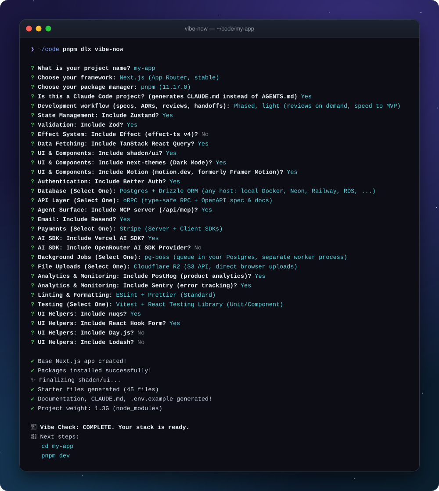

# Vibe Now 🌌

A premium, interactive CLI wizard for scaffolding modern full-stack React applications with a perfectly curated stack. Choose between **Next.js** or **TanStack Start**, pick your database, payments, and tooling — and start building within seconds.



## ✨ Features

- **Framework Choice**: Scaffold with **Next.js** (App Router) or **TanStack Start** (file-based routing, type-safe).
- **Package Manager Choice**: Use **npm**, **pnpm**, **Yarn**, or **Bun** for the whole scaffold (base app, installs, init commands) and in the generated docs. Defaults to the one you launched the wizard with; package managers that aren't installed are shown but disabled.
- **Interactive Wizard**: A beautiful CLI experience powered by Plop.js and Inquirer.
- **World-Class Feedback**: Engaged progress tracking with **Ora** spinners for a premium feel.
- **Smart Scaffolding**: Automatically orchestrates `create-next-app` or `@tanstack/cli create` and library-specific initializations (like `shadcn init` and `biome init`).
- **AI Project Support**: Generates **CLAUDE.md** (for Claude Code) or **AGENTS.md** (for Cursor/other AI assistants) tailored to your chosen stack.
- **Phased Development Workflow**: Optionally sets the project up to be built one sub-phase at a time: research, spikes, a spec per sub-phase, ADRs, reviews and handoffs. Choose **light** (reviews on demand, speed to MVP) or **gated** (independent reviews before every merge). Adds the Workflow section to CLAUDE.md / AGENTS.md, a `docs/` skeleton (master checklist, spec / spike / ADR templates, ADR 0001 and 0002, indexes), `typecheck` and `check` scripts, and for Claude Code projects the `handoff`, `backend-review`, `security-review`, `frontend-review` and `docs-review` skills.
- **Auto `.env.example`**: Generates a `.env.example` with all required environment variables grouped by package.
- **Template System**: Powered by Handlebars templates in the `templates/` directory for highly customized project initialization.
- **Safety First**: Project name validation and directory check to prevent accidental overwrites.

## 🛠️ The Curated Stack

### Framework (choose one)
- **Next.js** (App Router, TypeScript, Tailwind CSS v4)
- **TanStack Start** (File-based routing, TypeScript, Tailwind CSS v4)

### Package Manager (choose one)
- **npm**, **pnpm**, **Yarn** (1.x or 2+), or **Bun**

### Development Workflow (choose one)
- **Phased, light**: one sub-phase at a time, reviews on demand
- **Phased, gated**: one sub-phase at a time, independent reviews before every merge
- **None**

### Optional Libraries
- **State**: Zustand
- **Validation**: Zod
- **Effect System**: Effect (effect-ts v4), with a starter service and a shared runtime in `lib/effect/`
- **Data Fetching**: TanStack React Query
- **UI & Components**: shadcn/ui, next-themes (Next.js) / tanstack-theme-kit (TanStack), Motion (motion.dev, formerly Framer Motion)
- **Database (choose one)**: Supabase + Drizzle ORM, plain Postgres + Drizzle ORM (any host, no Supabase), Convex (Cloud), Convex (Self-hosted), SQLite via Turso + Drizzle, or self-hosted SQLite/libSQL + Drizzle
- **API Layer (choose one)**: oRPC (typed RPC + REST with an OpenAPI spec & docs) or tRPC, with a working example router (skipped for Convex)
- **Agent Surface**: an MCP server at `/api/mcp` (stateless Streamable HTTP, MCP SDK v2). With oRPC, every procedure is an MCP tool automatically; otherwise a hand-written tool registry. Without `MCP_API_KEY` it is open in development and refuses every request in production
- **Background Jobs (choose one)**: pg-boss (queue in your Postgres + a worker process; needs Postgres or Supabase), Inngest (durable functions over HTTP), or Trigger.dev (hosted task runners), each with a typed example job and its dev scripts
- **File Uploads (choose one)**: UploadThing (hosted storage + upload UI; not offered with Effect v4, since it bundles Effect 3) or Cloudflare R2 (S3 API, short-lived presigned uploads with type and size enforced)
- **Analytics & Monitoring**: PostHog (product analytics; `/ingest` reverse proxy on Next.js) and Sentry (error tracking), together or apart; both stay silent until their keys are set
- **Authentication**: Better Auth
- **Email**: Resend
- **Payments (choose one)**: Stripe or Polar.sh
- **AI SDK**: Vercel AI SDK & OpenRouter Provider support
- **Linting & Formatting (choose one)**: ESLint + Prettier or Biome
- **Testing (choose one)**: Vitest + React Testing Library, Playwright, or both
- **UI Helpers**: nuqs (Next.js only), React Hook Form, Day.js, Lodash

---

## 🚀 Quick Start

Launch the wizard without installation:

```bash
npx vibe-now
# or
pnpm dlx vibe-now
yarn dlx vibe-now   # Yarn 2+ (on Yarn 1, use npx)
bunx vibe-now
```

The package manager you launch with is preselected in the wizard.

---

## 🛠️ Local Development

Clone the repo to customize the logic or add your own favorite packages.

### 1. Installation
```bash
git clone https://github.com/mosster/vibe-now.git
cd vibe-now
npm install
```

### 2. Linking for Development
To use the `vibe-now` command globally on your machine while developing:
```bash
npm link
```
Now you can run `vibe-now` from any directory!

### 3. Adding New Packages
The CLI uses a group-based configuration for easy maintenance. To add a new library:
1. Open `lib/packages.js`.
2. Find the relevant `PACKAGE_GROUPS` entry or add a new one.

```javascript
{
  category: 'My New Category',
  items: [
    {
      id: 'myPackage',
      name: 'Cool Library',
      install: ['cool-lib-package'],
      default: false
    }
  ]
}
```

Keep package config package-manager neutral:
- Init commands are `{ dlx: [...] }` (run a registry package once, e.g. `shadcn@latest`) or `{ exec: [...] }` (run a binary the project installed, e.g. `playwright`). Never write `npx` directly.
- In `guidance` and env var comments, write `{pm:run}` for scripts (`{pm:run} test`), `{pm:exec}` for local binaries, and `{pm:dlx}` for registry packages. They are replaced with the chosen package manager's commands.

### 4. Adding New Templates
The wizard generates `README.md`, `CLAUDE.md` or `AGENTS.md`, and `.env.example` automatically. To add a new template:
1. Create a Handlebars file in the `templates/` directory (e.g., `templates/CONFIG.md.hbs`).
2. Open `plopfile.js`.
3. Locate the `// 3. Generate README and AGENTS files` section.
4. Add your new template read and write logic:

```javascript
const myTmpl = fs.readFileSync(path.join(__dirname, 'templates/CONFIG.md.hbs'), 'utf8');
const renderedMy = plop.renderString(myTmpl, templateData);
fs.writeFileSync(path.join(projectPath, 'CONFIG.md'), renderedMy);
```

---

## 🤖 Prompting Examples for AI

Since most development on this CLI is done using AI assistants (Cursor, Claude, etc.), here are some proven prompts to extend the tool:

### To add a new library:
> "I want to add `lucide-react` to the UI Helpers category. It should be enabled by default. Add it to the configuration in `lib/packages.js` and suggest a good engineering guidance string for the AGENTS.md file."

### To add a new Mutual Exclusive option:
> "Add a new 'Database Driver' category under Database. It should be a single-choice list between 'Postgres (pg)' and 'SQLite (libsql)'. Map this correctly in the `providerConfig` so it installs the right packages."

### To add a new documentation template:
> "Create a new template `templates/ENVIRONMENT.hbs` that lists required .env variables for the selected packages. Then, update `plopfile.js` to render this as `.env.example` in the project root."

### To modify project validation:
> "Update the project name validation in `plopfile.js` to also check if the name is too long (over 100 characters) and return a custom error message."

---

## 📦 Publishing

When you're ready to release a new version:

1. Update version: `npm version patch` (or minor/major)
2. Login: `npm login`
3. Publish: `npm publish --access public`

---

## 📜 License
MIT © [Ed Moss](https://github.com/mosster)
